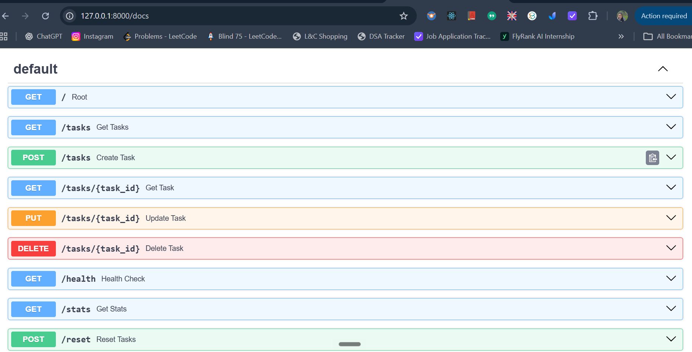

# FastAPI Task CRUD API

A simple REST API built with FastAPI for managing tasks. This project was created as part of the FlyRank AI Internship Week 2 assignment to practise backend development, CRUD operations, request validation, HTTP status codes and API testing.

## Features

- Create, read, update and delete tasks
- Validate task input and return appropriate HTTP status codes
- Filter tasks by completion status
- Search task titles without case sensitivity
- Calculate task statistics
- Reset tasks to the initial example data
- Interactive API documentation using Swagger UI
- In-memory data storage without a database

## Tech Stack

- Python
- FastAPI
- Uvicorn
- Pydantic
- Git and GitHub

## Project Structure

```text
fastAPI CRUD assignment/
├── __pycache__/
├── .vscode/
├── env/
├── main.py
├── README.md
├── .gitignore
└── screenshots/
    └── swagger-ui.png
```


## Installation

### 1. Clone the repository

```bash
git clone https://github.com/Chithranjaly/FastAPI-CRUD-API-assigment-W2.git
cd FastAPI-CRUD-API-assigment-W2
```

### 2. Create a virtual environment

```powershell
python -m venv .venv
```

Activate it in Windows PowerShell:

```powershell
.\.venv\Scripts\Activate.ps1
```

### 3. Install dependencies

```powershell
python -m pip install fastapi uvicorn
```

## Run the Application

Start the development server from the project directory:

```powershell
python -m uvicorn main:app --reload
```

The API is available at:

- API root: http://127.0.0.1:8000/
- Health check: http://127.0.0.1:8000/health
- Swagger UI: http://127.0.0.1:8000/docs

## API Endpoints

| Method | Endpoint | Description | Success status |
|---|---|---|---|
| GET | `/` | API information | 200 |
| GET | `/health` | Check application health | 200 |
| GET | `/tasks` | Retrieve all tasks | 200 |
| GET | `/tasks/{task_id}` | Retrieve one task | 200 |
| POST | `/tasks` | Create a task | 201 |
| PUT | `/tasks/{task_id}` | Update a task's title and/or completion status | 200 |
| DELETE | `/tasks/{task_id}` | Delete a task | 204 |
| GET | `/stats` | Retrieve task statistics | 200 |
| POST | `/reset` | Restore the initial example tasks | 200 |

### Filtering and Search

The `GET /tasks` endpoint supports optional query parameters.

- `done=true`: return completed tasks.
- `done=false`: return incomplete tasks.
- `search=milk`: search task titles for the word "milk".
- Both parameters can be combined.

Example:

```text
GET /tasks?done=true&search=milk
```

Search is case-insensitive. If no tasks match, the API returns an empty list.

## Example Requests

### Create a task

```powershell
curl.exe -i -X POST "http://127.0.0.1:8000/tasks" -H "Content-Type: application/json" -d "{\"title\":\"Buy milk\"}"
```

Example response, with headers shortened:

```http
HTTP/1.1 201 Created
content-type: application/json
```

```json
{
  "id": 4,
  "title": "Buy milk",
  "done": false
}
```

The assigned ID depends on the tasks currently in memory.

### Retrieve all tasks

```powershell
curl.exe -i "http://127.0.0.1:8000/tasks"
```

### Update a task

```powershell
curl.exe -i -X PUT "http://127.0.0.1:8000/tasks/1" -H "Content-Type: application/json" -d "{\"done\":true}"
```

### Delete a task

```powershell
curl.exe -i -X DELETE "http://127.0.0.1:8000/tasks/1"
```

A successful deletion returns `204 No Content` with an empty response body.

## Validation and Error Handling

| Status | Meaning |
|---|---|
| 200 | Request succeeded |
| 201 | Task created successfully |
| 204 | Task deleted successfully, with no response body |
| 400 | Missing, empty or invalid request body |
| 404 | Requested task ID does not exist |

Error responses use a JSON `error` field, for example:

```json
{
  "error": "Task 99 not found"
}
```

## Testing with Swagger UI

Open http://127.0.0.1:8000/docs while the server is running.

Use **Try it out** to test each endpoint, including successful requests and error cases. Verify the returned status codes and JSON responses.

## In-Memory Storage Experiment

Tasks are stored in a Python list in memory, so changes are temporary and are not saved to a database or file. Restarting the server recreates the initial three example tasks, which demonstrates why persistent storage is needed when data must survive an application restart.

## Swagger UI Screenshot


